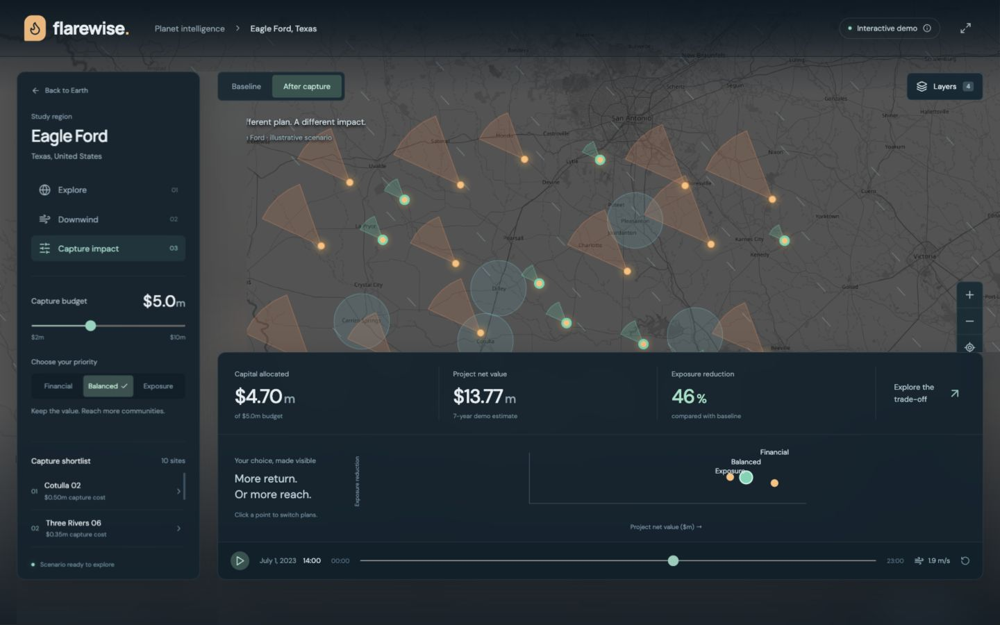

# LifeLine · FlareWise demo

An interactive hackathon prototype for exploring gas flares, wind, communities, and capture-project trade-offs.

## Run locally

```sh
cd demo
npm ci
npm run dev -- --port 5173
```

Open http://localhost:5173. Requires Node.js 20.19+ or a compatible newer release.

## Build

```sh
cd demo
npm run build
```

The production files are generated in `demo/dist`.

## Explore

- Interactive globe and camera flight to Eagle Ford, Texas.
- Financial, Balanced, and Exposure scenario presets.
- Budget slider updating selected projects and summary metrics.
- Hourly wind playback and illustrative downwind footprints.
- Baseline/after-capture comparison.
- Layer controls for flares, wind, community circles, illustrative pipelines, capture selections, and population/age views.
- Clickable site and community details, plus an interactive scenario chart.

All site locations, financial values, population figures, and exposure results are illustrative. This prototype demonstrates interactions; it does not provide validated financial or health estimates. Map tiles and fonts require internet access.



See [demo documentation](demo/README.md) for more details.
